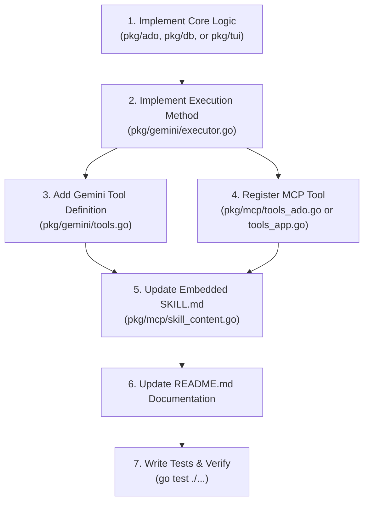

# 🤖 AGENTS.md — Contributor & AI Agent Guidelines

Welcome to the **ado-board-cli** codebase! This document provides core architectural standards, engineering conventions, and step-by-step workflows for AI coding agents and human contributors working on this repository.

---

## 🏛️ Core Principles & Conventions

1. **Binary Name Convention**:
   - The application binary name is strictly **`ado-board-cli`** (never omit the `-cli` suffix).
   - In documentation, error messages, flags, and build scripts, always refer to the binary as `ado-board-cli`.

2. **Self-Contained Single Binary Release**:
   - `ado-board-cli` is distributed as a single standalone binary with zero external runtime dependencies.
   - Uses pure-Go SQLite (`modernc.org/sqlite`) without CGO.
   - All assets, including the **`SKILL.md`** documentation for external AI agents, are hardcoded directly into the binary (`pkg/mcp/skill_content.go`).

3. **Single-Source-of-Truth Tool Execution**:
   - Do **NOT** duplicate ADO API or TUI business logic between the Gemini AI assistant and the MCP server.
   - All tools share a single unified execution engine in [`pkg/gemini/executor.go`](pkg/gemini/executor.go).
   - Both Gemini function calling and MCP tool invocations route through `Executor.Execute(...)` or the IPC bridge.

4. **Dual-Mode Operation (Headless + Live TUI IPC)**:
   - When the TUI is running, external agents and MCP tools communicate with it in real time via local Inter-Process Communication (`pkg/ipc`).
   - When the TUI is offline, tools fall back to direct Azure DevOps REST API calls and local SQLite database updates seamlessly.

5. **Local Workspace Configuration by Default**:
   - `ado-board-cli mcp setup <target>` (e.g., `claude`, `agents`, `deepseek`) writes to the local project directory (`./.mcp.json`, `./.claude.json`, `./.dsh/`, `./.gemini/skills/ado-board/SKILL.md`) by default.
   - Global user environment installs (`~/.claude.json`, `~/.dsh/cordis.patch.yml`, `~/.gemini/config/`) must be explicitly requested via the `--global` (`-g`) flag.

---

## 🏗️ Codebase Layout & Layer Responsibilities

```
ado-board-cli/
├── cmd/                      # Cobra CLI commands & subcommands
│   ├── root.go               # TUI launcher and global flags (--token, --org, --project, --db)
│   ├── track.go / untrack.go # Root & query tracking commands
│   ├── sync.go / list.go     # ADO sync and terminal hierarchy printer
│   ├── create.go / edit.go   # Work item CRUD & estimate commands
│   ├── status.go / assign.go # Status transitions and assignee commands
│   ├── comment.go / delete.go# Discussions and deletion
│   ├── get.go / set.go       # Persistent settings manager
│   └── mcp.go                # MCP stdio server launcher & automated setup
├── pkg/
│   ├── ado/                  # Azure DevOps REST API Client (Resty v3)
│   │   ├── client.go         # Work item crawler, JSON-patch updates, PR links, project members
│   │   └── types.go          # ADO payload models, WIQL queries, link parsing
│   ├── config/               # Configuration manager (PAT token, API keys, org/project defaults)
│   ├── db/                   # Pure-Go SQLite storage engine
│   │   ├── db.go             # Migrations, tracked roots/queries, identity cache, settings
│   │   └── tree.go           # Hierarchy builder, rollup calculations, filters, search
│   ├── gemini/               # Gemini AI Agent & Unified Tool Engine
│   │   ├── agent.go          # Gemini conversation builder, token manager, streaming
│   │   ├── executor.go       # Central execution engine for ALL tool actions
│   │   └── tools.go          # Function definitions and JSON schema specifications
│   ├── ipc/                  # Local Inter-Process Communication
│   │   └── ipc.go            # Unix domain sockets (Linux/macOS) & loopback TCP (Windows)
│   ├── mcp/                  # Model Context Protocol (MCP) Server
│   │   ├── server.go         # MCP Server instance setup (mcp-go)
│   │   ├── tools_ado.go      # ADO work item & query MCP tools
│   │   ├── tools_app.go      # Live TUI control & telemetry MCP tools
│   │   └── skill_content.go  # Embedded SKILL.md text and config setup generators
│   └── tui/                  # Bubble Tea & Lipgloss Terminal Interface
│       ├── app.go            # Central state machine, message routing, IPC listener
│       ├── screen_tree.go    # Screen 1: Home tree view, tabs, filters
│       ├── screen_item.go    # Screen 2: Item details, PR links, comments
│       ├── screen_create.go  # Screen 3: Work item creation form
│       ├── screen_settings.go# Screen 4: Application preferences & keys
│       ├── dock_gemini.go    # Collapsible AI copilot dock
│       └── modal_*.go        # Modal dialogs (Track, Filter, Status, Assign, Estimate, Dates, Tabs)
└── AGENTS.md                 # Agent instructions & development guide
```

---

## 🛠️ Step-by-Step: Adding New Features & Exposing MCP Tools

Whenever you add new functionality to `ado-board-cli`—whether it is a new Azure DevOps operation or a new TUI capability—follow this checklist to ensure complete system parity and test coverage:



---

### Step 1: Implement Core Logic

- **ADO REST API Operation**:
  - Add API client methods in [`pkg/ado/client.go`](pkg/ado/client.go).
  - Use Resty v3 and handle JSON-Patch payloads correctly (`System.Title`, `System.Description`, `Microsoft.VSTS.Scheduling.OriginalEstimate`, `Microsoft.VSTS.Common.Priority`, etc.).
  - Update cached database records in [`pkg/db/db.go`](pkg/db/db.go) if local cache is affected.

- **Live TUI Interaction**:
  - Add the new command enum to [`pkg/ipc/ipc.go`](pkg/ipc/ipc.go) (e.g., `CmdCustomAction CommandType = "custom_action"`).
  - Add any necessary parameters to `ipc.Request` and responses to `ipc.Response`.
  - In [`pkg/tui/app.go`](pkg/tui/app.go), handle `CmdCustomAction` inside the `MsgIPCRequest` message handler.

---

### Step 2: Implement Execution in `pkg/gemini/executor.go`

Add the execution method to `Executor` in [`pkg/gemini/executor.go`](pkg/gemini/executor.go):

```go
func (e *Executor) executeCustomAction(args map[string]any) (map[string]any, error) {
    paramVal := getString(args, "param_name")
    if paramVal == "" {
        return nil, fmt.Errorf("param_name is required")
    }

    // If it's a live TUI action, send via IPC with fallback:
    ctx, cancel := context.WithTimeout(context.Background(), 2*time.Second)
    defer cancel()
    resp, err := ipc.SendCommand(ctx, ipc.Request{
        Command:     ipc.CmdCustomAction,
        CustomField: paramVal,
    })
    if err == nil && resp.Success {
        return map[string]any{
            "success": true,
            "status":  "success",
            "message": resp.Message,
        }, nil
    }

    // Offline / direct fallback logic...
    return map[string]any{
        "success": true,
        "status":  "success",
        "message": "Executed custom action",
    }, nil
}
```

Then register the tool name in the `Execute` switch block:

```go
case "custom_action":
    return e.executeCustomAction(args)
```

---

### Step 3: Register Gemini Tool Definition in `pkg/gemini/tools.go`

In [`pkg/gemini/tools.go`](pkg/gemini/tools.go), add the schema to `GetTools(canConfirm bool)`:

```go
{
    Name: "custom_action",
    Description: "Performs custom action on the board or active work item.",
    Parameters: &genai.Schema{
        Type: genai.TypeObject,
        Properties: map[string]*genai.Schema{
            "param_name": {
                Type:        genai.TypeString,
                Description: "Description of the parameter.",
            },
        },
        Required: []string{"param_name"},
    },
},
```

---

### Step 4: Register MCP Tool in `pkg/mcp/`

- For ADO data operations, edit [`pkg/mcp/tools_ado.go`](pkg/mcp/tools_ado.go).
- For live TUI app control, edit [`pkg/mcp/tools_app.go`](pkg/mcp/tools_app.go).

Example tool registration:

```go
s.AddTool(
    mcp.NewTool(
        "custom_action",
        mcp.WithDescription("Performs custom action on the board or active work item."),
        mcp.WithString("param_name", mcp.Required(), mcp.Description("Description of the parameter.")),
    ),
    func(ctx context.Context, request mcp.CallToolRequest) (*mcp.CallToolResult, error) {
        exec := getExecutor()
        res, err := exec.Execute("custom_action", request.Params.Arguments)
        if err != nil {
            return mcp.NewToolResultError(fmt.Sprintf("Failed: %v", err)), nil
        }
        jsonBytes, _ := json.MarshalIndent(res, "", "  ")
        return mcp.NewToolResultText(string(jsonBytes)), nil
    },
)
```

---

### Step 5: Update Embedded `SKILL.md` in `pkg/mcp/skill_content.go`

Edit `EmbeddedSkillMarkdown` in [`pkg/mcp/skill_content.go`](pkg/mcp/skill_content.go):
- Add the new tool to the **Tool Reference** section (`### ADO Data & Workflow Tools` or `### Live App Control Tools`).
- Document all required and optional parameters.
- Provide workflow patterns explaining when external agents should call this tool.

---

### Step 6: Update User Documentation in `README.md`

In [`README.md`](README.md):
- Add any new TUI keyboard shortcuts to the **Interactive TUI Guide & Shortcuts Reference** table.
- Add any new CLI command or flag to the **CLI Scripting & Automation Reference**.
- Add the new tool to the **Available MCP Tools Reference** table.

---

### Step 7: Write Unit Tests & Verify

1. Add unit tests for the execution method in [`pkg/gemini/gemini_test.go`](pkg/gemini/gemini_test.go).
2. Add MCP handler tests in [`pkg/mcp/mcp_test.go`](pkg/mcp/mcp_test.go).
3. If new CLI flags or commands were added, add tests in [`cmd/mcp_test.go`](cmd/mcp_test.go).
4. Run the full test suite:
   ```bash
   go test -v ./... -count=1
   ```
5. Ensure clean compilation:
   ```bash
   go build -o bin/ado-board-cli .
   ```

---

## 💡 Important Edge Cases & Tips

- **Windows Compatibility**:
  - Windows does not support standard Unix Domain Sockets in all environments; `pkg/ipc` automatically uses loopback TCP ports on Windows. Keep all IPC payload handling platform-agnostic.
- **Multiple TUI Instances**:
  - `pkg/ipc` scans active sockets and connects to the most recently active TUI instance.
- **Plain-Text Credentials in Settings**:
  - PAT tokens and Gemini keys in the Settings screen are displayed as clear text for transparency.
- **Context Awareness in Prompts**:
  - Whenever a user prompt refers to *"this item"*, *"current story"*, or *"what am I looking at"*, always invoke `app_get_state` or `get_selected_item` first before asking the user for a work item ID.
